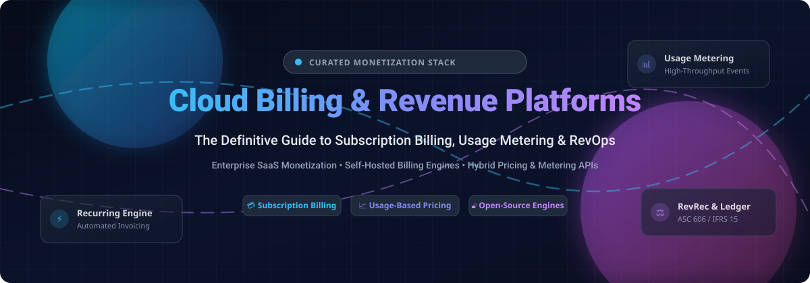

<p align="center">
  
</p>

# 💳 Awesome Cloud Billing & Revenue Platform

<p align="center">
  <a href="https://github.com/ishandutta2007/Awesome-Awesome-Awesome"></a><a href="https://discord.gg/jc4xtF58Ve"></a>
  <a href="https://github.com/ishandutta2007/Awesome-Cloud-Billing-Revenue-Platform/stargazers"></a>
  <a href="https://github.com/ishandutta2007/Awesome-Cloud-Billing-Revenue-Platform/network/members"></a>
  <a href="https://github.com/ishandutta2007/Awesome-Cloud-Billing-Revenue-Platform/issues"></a>
  <a href="https://github.com/ishandutta2007/Awesome-Cloud-Billing-Revenue-Platform/blob/main/LICENSE"></a>
  <a href="https://github.com/ishandutta2007"></a>
</p>

> 🚀 **A curated directory of cloud billing engines, subscription management software, usage-based metering platforms, and open-source revenue automation systems for modern SaaS and AI businesses.**

---

## 📑 Table of Contents

- [🌐 Sector Overview & Market Dynamics](#-sector-overview--market-dynamics)
- [🏢 SaaS & Hosted Billing Platforms](#-saas--hosted-billing-platforms)
- [🔓 Open-Source GitHub Projects](#-open-source-github-projects)
- [🛠️ Architectural Patterns for Modern Billing](#-architectural-patterns-for-modern-billing)
- [🤝 How to Contribute](#-how-to-contribute)
- [💖 Support & Sponsorship](#-support--sponsorship)
- [📈 Star History](#-star-history)
- [⚠️ Disclaimer](#️-disclaimer)

---

## 🌐 Sector Overview & Market Dynamics

The global **subscription and billing management software market** is estimated at **$8.6 billion to $10.0 billion in 2026** and is projected to expand to **over $18 billion to $20 billion by 2030** (growing at a CAGR of ~16–17%), propelled by accelerating cloud transitions, AI inference consumption billing, and automated global e-invoicing compliance. The sector remains **moderately fragmented** rather than "winner-take-all"; while financial rails and enterprise incumbents like Stripe, Zuora, and Chargebee anchor significant transaction volume, the market features widespread diversity spanning specialized Merchant of Record (MoR) providers, niche CPQ/revrec suites, and a rapidly expanding cohort of self-hosted, open-source metering engines.

---

## 🏢 SaaS & Hosted Billing Platforms

The table below compiles leading hosted and SaaS recurring billing platforms, sorted descending by company scale (market valuation / ARR benchmark).

| Product | Scale (Valuation / Revenue) | Description | Starting Pricing | Free Tier / Trial Limits |
|:---|:---|:---|:---|:---|
| **[Stripe Billing](https://stripe.com/billing)** | **$159B Valuation** (Processes >$1T/yr) | Developer-first recurring billing with flexible subscriptions, usage-based invoicing, proration, and automated smart retries. Payment gateway fees (2.9% + $0.30) are separate from billing volume charges. | 0.70% of recurring billing volume (pay-as-you-go model) | No free tier; 0.70% billing fee applies starting from the first processed dollar (test-mode sandbox is free) |
| **[Chargebee](https://www.chargebee.com/)** | **$3.5B Valuation** (~$100M+ ARR) | Enterprise subscription management and recurring billing platform configured for hybrid pricing models (credits, actions, and seat tiers) with built-in collections and CPQ. | Flow Plan: $0 base + 0.80% of monthly billing volume, or $99/month + 0.65% | No permanent free tier; 14-day full-feature free trial available (plus Flow PAYG has $0 fixed fee but charges 0.80% per dollar) |
| **[Zuora](https://www.zuora.com/)** | **~$1.6B Market Cap / Public** (~$453M Revenue) | Comprehensive enterprise order-to-cash platform providing complex subscription management, CPQ, global multi-entity hierarchies, and automated revenue recognition (ASC 606 / IFRS 15). | Starting at ~$1,500–$3,500/month (typical mid-market deployment total contract ~$170,000/yr) | No permanent free tier and no self-serve free trial; guided sandboxes and live product tours are provided upon demo request |
| **[Paddle](https://www.paddle.com/)** | **$1.4B Valuation** (~$75M–$100M Revenue) | Complete Merchant of Record (MoR) billing platform managing checkout, subscription lifecycle, currency conversions, localized payment methods, and global sales tax/VAT compliance. | 5.0% + $0.50 per successful checkout transaction (B2B wire invoicing at 3.5%) | No permanent free tier; accounts are free to set up and integrate with zero platform fee until first live transaction is collected |
| **[Recurly](https://recurly.com/)** | **PE Backed (Accel-KKR)** (~$55M–$60M Revenue) | Subscription management engine designed for high-volume consumer and B2B SaaS, featuring intelligent dunning recovery, churn reduction, and gateway routing. | Starter Plan: $249/month + 0.90% of revenue (includes first $40,000 in monthly billings) | No permanent free tier; full-access developer sandbox provided indefinitely to build and test before activating production |
| **[Maxio](https://www.maxio.com/)** | **PE Backed** (~$49M Revenue) | Financial operations, B2B SaaS subscription billing, and revenue analytics engine created via the merger of Chargify and SaaSOptics. | Grow Plan: $599/month (covers up to $100,000 in monthly billing volume) | No permanent free tier; 30-day developer evaluation sandbox access available upon onboarding |
| **[BillingPlatform](https://billingplatform.com/)** | **Growth Equity Backed** (~$45M ARR) | Enterprise quote-to-cash and cloud billing solution with dynamic usage rating engines, complex bundle configurations, and multi-currency invoicing. | Starting at ~$2,500/month (enterprise contracts typically scale to $100,000+/year) | No permanent free tier; 14-day interactive test-drive trial and guided sandboxes offered through sales |
| **[FastSpring](https://fastspring.com/)** | **Growth Equity Backed** (~$30M–$50M Revenue) | Merchant of Record platform tailored for software, digital downloads, and SaaS products with bundled payments, VAT/tax handling, and checkout localization. | Starting fee of 5.9% + $0.95 per transaction (or volume-negotiated flat percentage tiers) | No permanent free tier and no public self-serve free trial; custom quotes and test sandboxes provided via sales onboarding |
| **[Ordway](https://ordwaylabs.com/)** | **$20M Raised** (~$5M–$10M Revenue) | Modern billing and revenue automation software featuring AutoPay, consumption thresholds, dunning workflows, and ERP cash application sync. | Starting at ~$800/month (mid-market standard tiers scale between $1,000–$3,000/month) | No permanent free tier and no self-serve free trial; guided demos and sandbox proofs-of-concept are arranged by consultation |
| **[Rebilly](https://www.rebilly.com/)** | **Bootstrapped / Private** (~$5M Revenue) | Developer-centric subscription billing, payment orchestration, and checkout optimization suite designed to minimize payment processing fees. | Pro Plan: $125/month base + 1.00% of monthly revenue (includes up to 10 team seats) | No permanent free tier; 14-day free trial on the Pro plan with all features unlocked and zero base fee during trial |

---

## 🔓 Open-Source GitHub Projects

Curated self-hosted billing engines, open metering layers, and financial infrastructure projects on GitHub. Sorted descending by GitHub star count:

| Project | Star Badge | Language / Stack | Description |
|:---|:---:|:---:|:---|
| **[Hyperswitch](https://github.com/juspay/hyperswitch)** | [](https://github.com/juspay/hyperswitch/stargazers) | Rust | High-performance, open-source payment switch and financial router that powers unified checkout, subscription routing, and global payment provider integrations. |
| **[Lago](https://github.com/getlago/lago)** | [](https://github.com/getlago/lago/stargazers) | Ruby / Go / TS | Open-source usage-based billing API and metering infrastructure with hybrid pricing models, wallet credits, invoicing engines, and payment gateway orchestration. |
| **[Invoice Ninja](https://github.com/invoiceninja/invoiceninja)** | [](https://github.com/invoiceninja/invoiceninja/stargazers) | PHP / Flutter | Self-hosted invoicing, recurring billing, client portals, and payment collection platform built for freelancers, agencies, and small-to-medium businesses. |
| **[Akaunting](https://github.com/akaunting/akaunting)** | [](https://github.com/akaunting/akaunting/stargazers) | PHP / Laravel | Full-featured open-source accounting and double-entry management software with built-in subscription billing, recurring invoice generation, and expense tracking. |
| **[Crater](https://github.com/crater-invoice/crater)** | [](https://github.com/crater-invoice/crater/stargazers) | PHP / Vue.js | Open-source invoicing, recurring billing, and payment tracking suite equipped with cross-platform mobile apps for iOS and Android. |
| **[Flexprice](https://github.com/flexprice/flexprice)** | [](https://github.com/flexprice/flexprice/stargazers) | Go / TypeScript | Developer-first, open-source usage-based pricing and billing engine supporting real-time event metering, prepaid wallet top-ups, and feature access entitlement gates. |
| **[Kill Bill](https://github.com/killbill/killbill)** | [](https://github.com/killbill/killbill/stargazers) | Java | Battle-tested, enterprise open-source subscription billing and payments engine with hierarchical product catalogs, dunning automation, and multi-tenant architectures. |
| **[OpenMeter](https://github.com/openmeterio/openmeter)** | [](https://github.com/openmeterio/openmeter/stargazers) | Go / ClickHouse | Cloud-native, high-throughput usage metering engine designed for AI models, API calls, and developer platforms to track real-time consumption and check entitlements. |
| **[FOSSBilling](https://github.com/FOSSBilling/FOSSBilling)** | [](https://github.com/FOSSBilling/FOSSBilling/stargazers) | PHP | Community-driven, open-source billing and client automation management suite specifically optimized for web hosting companies, domain registrars, and cloud providers. |
| **[Meteroid](https://github.com/meteroid-oss/meteroid)** | [](https://github.com/meteroid-oss/meteroid/stargazers) | Python / Vue.js | Open-source metering and billing infrastructure framework crafted for SaaS and AI products supporting grandfathered plans, tiered usage, and Stripe synchronization. |
| **[BillaBear](https://github.com/billabear/billabear)** | [](https://github.com/billabear/billabear/stargazers) | PHP / Symfony | Open-source subscription management and billing system with state-machine workflow automation, EU VAT reverse-charge calculations, and Stripe integration. |
| **[Recurso](https://github.com/recurso-dev/recurso)** | [](https://github.com/recurso-dev/recurso/stargazers) | Go / PostgreSQL | Modular open-source (MIT) billing engine for SaaS featuring double-entry ledgers, smart dunning schedules, 8 usage aggregation formulas, and Stripe/Chargebee data migrators. |

---

## 🛠️ Architectural Patterns for Modern Billing

When designing modern billing infrastructure, high-growth engineering teams frequently compose specialized open-source blocks:

```
┌────────────────────────┐      ┌─────────────────────────┐      ┌─────────────────────────┐
│ Usage Events / Streams │ ───► │ Metering & Aggregations │ ───► │ Subscription & Ledger   │
│ (Kafka / App Telemetry)│      │ (OpenMeter / Lago Core) │      │ (Kill Bill / Recurso)   │
└────────────────────────┘      └─────────────────────────┘      └─────────────────────────┘
                                                                              │
                                                                              ▼
┌────────────────────────┐      ┌─────────────────────────┐      ┌─────────────────────────┐
│ Revenue Recognition    │ ◄─── │ Invoicing & Tax Engines │ ◄─── │ Payment Routing Switch  │
│ (ASC 606 / Double-Entry│      │ (Invoice Ninja / TaxJar)│      │ (Hyperswitch / Stripe)  │
└────────────────────────┘      └─────────────────────────┘      └─────────────────────────┘
```

- **Usage Metering Layer**: Use high-throughput ingestion tools like **OpenMeter** or **Lago** to collect millions of consumption events per minute without degrading database performance.
- **Entitlements & State Engine**: Leverage **Kill Bill** or **BillaBear** to manage customer tiers, proration mathematics, and grace periods.
- **Payment Orchestration**: Route credit cards, SEPA, UPI, and ACH through **Hyperswitch** to reduce gateway lock-in and optimize acceptance rates.

---

## 🤝 How to Contribute

Contributions, project suggestions, and documentation refinements are warmly welcome! 

1. 🍴 Fork this repository.
2. 🌿 Create a branch for your addition (`git checkout -b feature/new-billing-tool`).
3. 📝 Update `README.md` keeping formatting, alphabetical or sorted orders, and factual data intact.
4. 🚀 Open a Pull Request detailing the changes.

---

## 💖 Support & Sponsorship

Thank you for visiting and using this resource! 🙏

If you find this curated ecosystem list helpful for your startup, architecture research, or billing integration:
- ⭐ **Star** this repository on GitHub to show your love and help others discover it.
- 🍴 **Fork** and contribute new tools, updates, or benchmark corrections.
- 📢 **Share** it with your engineering, finance, and revops teams or on social channels.
- ☕ **Buy me a coffee / Sponsor**: If you'd like to support ongoing curation and maintenance of open-source knowledge bases, consider sponsoring via the [GitHub Sponsors Dashboard](https://github.com/sponsors/ishandutta2007).

<p align="center">
  <a href="https://github.com/sponsors/ishandutta2007">
    
  </a>
</p>

---

## 📈 Star History

[](https://www.star-history.com/#ishandutta2007/Awesome-Cloud-Billing-Revenue-Platform&type=date&legend=top-left)

---

## ⚠️ Disclaimer

- This list is independently curated by the community for educational and informational purposes. It is not affiliated with or endorsed by any vendor.
- Billing platforms and financial systems must adhere to local tax jurisdictions (VAT, GST, sales tax) and statutory accounting standards (such as ASC 606 and IFRS 15). Always conduct thorough due diligence before selecting production billing infrastructure.
